  

   

  
  
  
  
  
  
  
  

   
   

  ### Engineering Intelligent Solutions. Building What's Next.

  

    <strong>Vistaran Techtronix</strong> is an AI-first enterprise technology and digital transformation company headquartered in Gandhinagar, India. We architect and ship production-ready autonomous agent systems, bespoke enterprise AI solutions, retrieval-augmented generation (RAG) platforms, resilient cloud infrastructure, and mission-critical software systems.
  

---

## 🧭 About Vistaran

At **Vistaran**, we combine advanced artificial intelligence engineering with rigorous full-stack software development. Since 2017, we have partnered with enterprises, scale-ups, and technology innovators worldwide to automate complex workflows, unlock proprietary business intelligence, and accelerate software deployment cycles.

Our engineering philosophy prioritizes **determinism**, **strict data sovereignty**, and **measurable business impact**. We bridge the divide between theoretical AI prototypes and enterprise-grade software built for uptime, compliance, and scale.

### Proven Enterprise Track Record

- **140+ Projects Delivered:** Shipped across cybersecurity, compliance, healthcare, logistics, e-commerce, and enterprise SaaS.
- **50+ Global Clients:** Trusted by organizations across the United States, United Kingdom, Germany, France, India, Australia, and Europe.
- **1,000+ Production Integrations:** Tool, database, and API pipelines built across Jira, Slack, Discord, Bitbucket, GitHub, AWS, Stripe, and Neo4j.
- **50+ Managed Cloud Infrastructures:** Multi-cloud architectures deployed and maintained on AWS (VPC / PrivateLink), Google Cloud, Azure, and DigitalOcean.
- **50+ Deployed AI Solutions:** Enterprise agent swarms, permission-aware RAG pipelines, micro-SaaS platforms, and private LLM hosting clusters.

---

## ⚡ Enterprise Services & Solutions

Explore our specialized service offerings across our four primary engineering disciplines:

<table>
  <thead>
    <tr>
      <th width="30%">Core Discipline</th>
      <th width="45%">Capabilities & Scope</th>
      <th width="25%">Live Service Links</th>
    </tr>
  </thead>
  <tbody>
    <tr>
      <td><strong>Autonomous AI Agents & Workflows</strong></td>
      <td>Deterministic agent swarms, Model Context Protocol (MCP) tool integration, Slack/Discord human approval gates, hybrid model cost routing, and automated SEO/coding agents.</td>
      <td>
        • <a href="https://www.vistaran.com/services/ai-agent-as-a-service">AI Agent as a Service</a> 
        • <a href="https://www.vistaran.com/services/ai-agent-development">AI Agent Development</a> 
        • <a href="https://www.vistaran.com/services/enterprise-ai-automation">Enterprise AI Automation</a> 
        • <a href="https://www.vistaran.com/services/ai-security-guardrails">Security & Guardrails</a>
      </td>
    </tr>
    <tr>
      <td><strong>Custom AI, RAG & Model Hosting</strong></td>
      <td>Permission-aware hybrid BM25 + vector search, SSO ACL pre-filtering, fine-tuned open-weight models (vLLM/Ollama), and zero-retention private cloud deployments.</td>
      <td>
        • <a href="https://www.vistaran.com/services/rag-development">RAG Development</a> 
        • <a href="https://www.vistaran.com/services/custom-llm-fine-tuning">Custom LLM Fine-Tuning</a> 
        • <a href="https://www.vistaran.com/services/private-llm-hosting">Private LLM Hosting (VPC)</a> 
        • <a href="https://www.vistaran.com/services/on-premise-ai-deployment">On-Premise Deployment</a>
      </td>
    </tr>
    <tr>
      <td><strong>Cloud Infrastructure & DevOps</strong></td>
      <td>AWS VPC isolated subnets, AWS KMS encryption, automated CI/CD pipelines, container orchestration, multi-stage Docker builds, and zero-downtime deployments.</td>
      <td>
        • <a href="https://www.vistaran.com/services/cloud-migration-devops">Cloud Migration & DevOps</a> 
        • <a href="https://www.vistaran.com/services/aws-services">AWS Cloud Services</a> 
        • <a href="https://www.vistaran.com/services/devops-services">DevOps Engineering</a>
      </td>
    </tr>
    <tr>
      <td><strong>Full-Stack & Custom Software Engineering</strong></td>
      <td>Scalable web and mobile applications, high-throughput REST and GraphQL APIs, real-time bidirectional WebSocket systems, and graph database reverse engineering.</td>
      <td>
        • <a href="https://www.vistaran.com/services/custom-software-development">Custom Software</a> 
        • <a href="https://www.vistaran.com/services/web-application-development">Web Applications</a> 
        • <a href="https://www.vistaran.com/services/mobile-application-development">Mobile Applications</a> 
        • <a href="https://www.vistaran.com/services/api-integrations">API & Third-Party Integrations</a>
      </td>
    </tr>
  </tbody>
</table>

---

## 🏛️ Flagship Platforms & Enterprise Portfolio

A selection of proprietary products and enterprise case studies engineered by Vistaran:

<table>
  <thead>
    <tr>
      <th width="32%">Project / Platform</th>
      <th width="48%">Architecture & Overview</th>
      <th width="20%">Domain & Stack</th>
    </tr>
  </thead>
  <tbody>
    <tr>
      <td>
        <a href="https://www.vistaran.com/products/scanview"><strong>ScanView</strong></a> 
        <a href="https://www.vistaran.com/case-studies/scanview">Read Case Study →</a>
      </td>
      <td>Enterprise penetration testing report generator that ingests raw outputs from tools like Nessus and Burp Suite into interactive, graph-based executive reports with Jira, Slack, and GitLab synchronization.</td>
      <td>
        <code>Cybersecurity</code> 
        <code>TypeScript</code> <code>FastAPI</code> <code>Graph Views</code>
      </td>
    </tr>
    <tr>
      <td>
        <a href="https://www.vistaran.com/case-studies/hermes-ai-agent"><strong>Hermes Multi-Agent Stack</strong></a> 
        <a href="https://www.vistaran.com/services/ai-agent-as-a-service">Agent Architecture →</a>
      </td>
      <td>Managed multi-agent execution framework combining OAuth2-scoped Model Context Protocol (MCP) tool connectors across Google Workspace, Bitbucket, Zoho, and Slack with deterministic write approvals and hybrid model cost routing.</td>
      <td>
        <code>Autonomous AI</code> 
        <code>MCP Protocol</code> <code>Python</code> <code>OAuth2</code>
      </td>
    </tr>
    <tr>
      <td>
        <a href="https://www.vistaran.com/case-studies/enterprise-rag-architecture"><strong>Permission-Aware RAG Platform</strong></a> 
        <a href="https://www.vistaran.com/services/rag-development">RAG Blueprint →</a>
      </td>
      <td>Enterprise semantic retrieval architecture combining hybrid BM25 + pgvector retrieval, corporate SSO ACL pre-filtering, and RAGAS evaluation suites to guarantee zero cross-department data leakage.</td>
      <td>
        <code>Enterprise RAG</code> 
        <code>pgvector</code> <code>Neo4j</code> <code>RAGAS</code>
      </td>
    </tr>
    <tr>
      <td>
        <a href="https://www.vistaran.com/case-studies/private-vpc-llm-deployment"><strong>Private VPC LLM Cluster</strong></a> 
        <a href="https://www.vistaran.com/services/private-llm-hosting">Sovereign Cloud →</a>
      </td>
      <td>Terraform-provisioned single-tenant vLLM inference engine inside isolated AWS VPC subnets with AWS KMS encryption, LiteLLM gateway, and sub-50ms Microsoft Presidio PII/PHI redaction.</td>
      <td>
        <code>Private Cloud</code> 
        <code>vLLM</code> <code>AWS VPC</code> <code>Presidio</code>
      </td>
    </tr>
    <tr>
      <td>
        <a href="https://www.vistaran.com/case-studies/compliance-view"><strong>Compliance View</strong></a> 
        <a href="https://www.vistaran.com/industries/ai-for-finance-and-banking">Compliance Suite →</a>
      </td>
      <td>Comprehensive PCI DSS compliance audit and governance management platform automating evidence collection, collaborative review workflows, and executive audit documentation.</td>
      <td>
        <code>GovTech / FinTech</code> 
        <code>React</code> <code>Node.js</code> <code>PostgreSQL</code>
      </td>
    </tr>
    <tr>
      <td>
        <a href="https://www.vistaran.com/case-studies/seo-wizard"><strong>SEO Wizard Dashboard</strong></a> 
        <a href="https://github.com/vistaran/seo-wizard-dashboard">Open Source Repo →</a>
      </td>
      <td>Technical SEO intelligence dashboard engineered for e-commerce and enterprise scale, automated audit execution, Core Web Vitals monitoring, and autonomous agent-led optimization.</td>
      <td>
        <code>E-Commerce</code> 
        <code>Next.js</code> <code>Shopify API</code> <code>AI Agent</code>
      </td>
    </tr>
    <tr>
      <td>
        <a href="https://www.vistaran.com/case-studies/fleetrun"><strong>Fleetrun Logistics</strong></a> 
        <a href="https://www.vistaran.com/industries/ai-for-logistics-supply-chain">Logistics Solution →</a>
      </td>
      <td>Full-stack telemetry and fleet management platform delivering real-time vehicle dispatch, driver route optimization, maintenance logging, and delivery status tracking.</td>
      <td>
        <code>Supply Chain</code> 
        <code>IoT</code> <code>Node.js</code> <code>WebSockets</code>
      </td>
    </tr>
    <tr>
      <td>
        <a href="https://www.vistaran.com/products/madhuras"><strong>Madhuras App</strong></a> 
        <a href="https://www.vistaran.com/products">Consumer Ecosystem →</a>
      </td>
      <td>Hyper-local food delivery and subscription marketplace connecting authentic meal providers with local consumers through order scheduling and dispatch management.</td>
      <td>
        <code>Consumer Tech</code> 
        <code>React Native</code> <code>Laravel</code> <code>MySQL</code>
      </td>
    </tr>
  </tbody>
</table>

---

## 🚀 Featured Open Source Projects

A selection of public developer tools, code seeds, and reusable utilities maintained across [`github.com/vistaran`](https://github.com/vistaran):

<table>
  <thead>
    <tr>
      <th width="35%">Repository</th>
      <th width="45%">Description</th>
      <th width="20%">Stack / Language</th>
    </tr>
  </thead>
  <tbody>
    <tr>
      <td>
        <a href="https://github.com/vistaran/ionic-modal-custom-transitions">
          <strong>ionic-modal-custom-transitions</strong>
        </a>
      </td>
      <td>Custom enter and leave animation/transition framework designed for Ionic modals and hybrid mobile views.</td>
      <td>
        
      </td>
    </tr>
    <tr>
      <td>
        <a href="https://github.com/vistaran/realtime-messaging-demo-using-socket.io">
          <strong>realtime-messaging-demo-using-socket.io</strong>
        </a>
      </td>
      <td>Real-time messaging seed platform supporting multi-room group chats, audio/video streaming, image previews, and document uploads.</td>
      <td>
        
        
      </td>
    </tr>
    <tr>
      <td>
        <a href="https://github.com/vistaran/speech-to-type">
          <strong>speech-to-type</strong>
        </a>
      </td>
      <td>Audio utility script that continuously captures voice streams and translates them in real time into operating system keyboard input events.</td>
      <td>
        
        
      </td>
    </tr>
    <tr>
      <td>
        <a href="https://github.com/vistaran/dynamic-graphql-from-neo4j">
          <strong>dynamic-graphql-from-neo4j</strong>
        </a>
      </td>
      <td>Automated schema and resolver generator reverse-engineering Neo4j graph databases to expose dynamic GraphQL APIs without manual schema authoring.</td>
      <td>
        
        
        
      </td>
    </tr>
    <tr>
      <td>
        <a href="https://github.com/vistaran/github-api-add-branch-and-collaborator">
          <strong>github-api-add-branch-and-collaborator</strong>
        </a>
      </td>
      <td>DevOps automation tool using GitHub REST API v3 for programmatic branch creation and automated collaborator onboarding.</td>
      <td>
        
        
      </td>
    </tr>
    <tr>
      <td>
        <a href="https://github.com/vistaran/angular-16-docker-example">
          <strong>angular-16-docker-example</strong>
        </a>
      </td>
      <td>Production-ready Docker multi-stage containerization blueprint and Nginx serving configuration for Angular 16 single-page applications.</td>
      <td>
        
        
      </td>
    </tr>
    <tr>
      <td>
        <a href="https://github.com/vistaran/event-management-and-booking-system">
          <strong>event-management-and-booking-system</strong>
        </a>
      </td>
      <td>Full-stack event booking and attendee management platform with role-based access, automated QR code link generation, and administrative control.</td>
      <td>
        
        
      </td>
    </tr>
    <tr>
      <td>
        <a href="https://github.com/vistaran/seo-wizard-dashboard">
          <strong>seo-wizard-dashboard</strong>
        </a>
      </td>
      <td>Technical SEO intelligence dashboard engineered for automated audit tracking and agent-assisted optimization workflows.</td>
      <td>
        
        
      </td>
    </tr>
    <tr>
      <td>
        <a href="https://github.com/vistaran/website-templates">
          <strong>website-templates</strong>
        </a>
      </td>
      <td>Curated frontend architectural templates and component boilerplates generated by specialized frontend expert agents.</td>
      <td>
        
        
      </td>
    </tr>
  </tbody>
</table>

---

## 🛠️ Technology Stack

Our engineering stack reflects the tools, languages, and frameworks actively deployed across production client engagements and internal architectures:

### Languages & Core Runtimes

  
  
  
  
  
  
  

### Frameworks & Libraries

  
  
  
  
  
  
  
  
  

### AI, Machine Learning & Data Architecture

  
  
  
  
  
  
  
  
  

### Infrastructure, Cloud & DevOps

  
  
  
  
  
  
  

---

## 🤝 Open Source & Collaboration

We actively share foundational tools, blueprints, and developer utilities with the community. We welcome contributions, issue reports, and architectural discussions across our public repositories.

### Contributor Workflow

1. **Explore Repositories:** Browse our [public repositories](https://github.com/orgs/vistaran/repositories) to find developer utilities, container configurations, and seeds.
2. **Issue Reporting:** Encountered a bug or edge-case? Open an issue in the target repository with reproduction steps, environment specifications, and runtime logs.
3. **Pull Request Protocol:**
   - Fork the repository and build from a dedicated branch (`git checkout -b feature/improvement-name`).
   - Adhere to the repository's existing linting and code style standards.
   - Write clear, atomic commits that explain *why* the change was made.
   - Reference any related issues in the PR description.

---

## 📬 Connect With Us

Let’s discuss building autonomous AI systems, scaling cloud infrastructure, or collaborating on engineering solutions.

<table>
  <tbody>
    <tr>
      <td width="30%"><strong>🌐 Official Website</strong></td>
      <td><a href="https://www.vistaran.com/">vistaran.com</a></td>
    </tr>
    <tr>
      <td><strong>💼 Enterprise Services</strong></td>
      <td><a href="https://www.vistaran.com/services">vistaran.com/services</a></td>
    </tr>
    <tr>
      <td><strong>📁 Client Portfolio & Case Studies</strong></td>
      <td><a href="https://www.vistaran.com/portfolio">vistaran.com/portfolio</a> | <a href="https://www.vistaran.com/case-studies">vistaran.com/case-studies</a></td>
    </tr>
    <tr>
      <td><strong>💼 LinkedIn</strong></td>
      <td><a href="https://www.linkedin.com/company/vistaran-tech/">linkedin.com/company/vistaran-tech</a></td>
    </tr>
    <tr>
      <td><strong>𝕏 Platform</strong></td>
      <td><a href="https://x.com/VistaranTech">@VistaranTech</a></td>
    </tr>
    <tr>
      <td><strong>✉️ Direct Inquiries</strong></td>
      <td><a href="mailto:jay@vistaran.tech">jay@vistaran.tech</a></td>
    </tr>
    <tr>
      <td><strong>🏢 Corporate Headquarters</strong></td>
      <td>302, Shagun 11, opp. Ramkatha Ground, Sector 11, Gandhinagar, Gujarat 382010, India</td>
    </tr>
  </tbody>
</table>

 

  © Vistaran Techtronix Pvt. Ltd. Engineered with precision.

